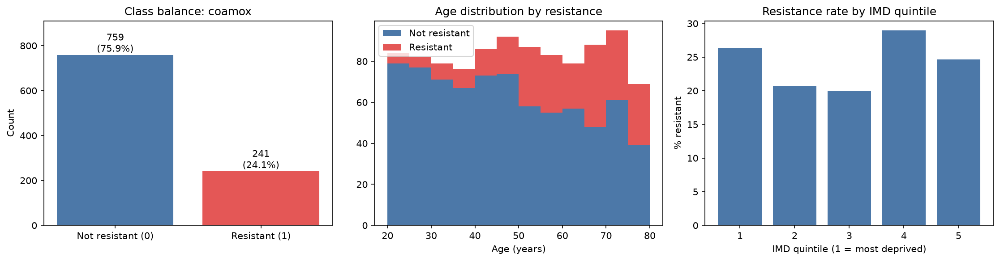
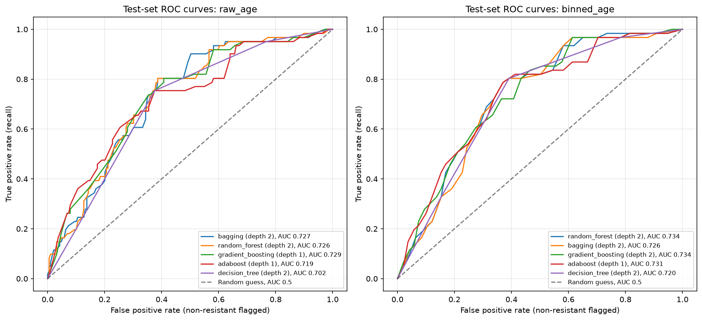
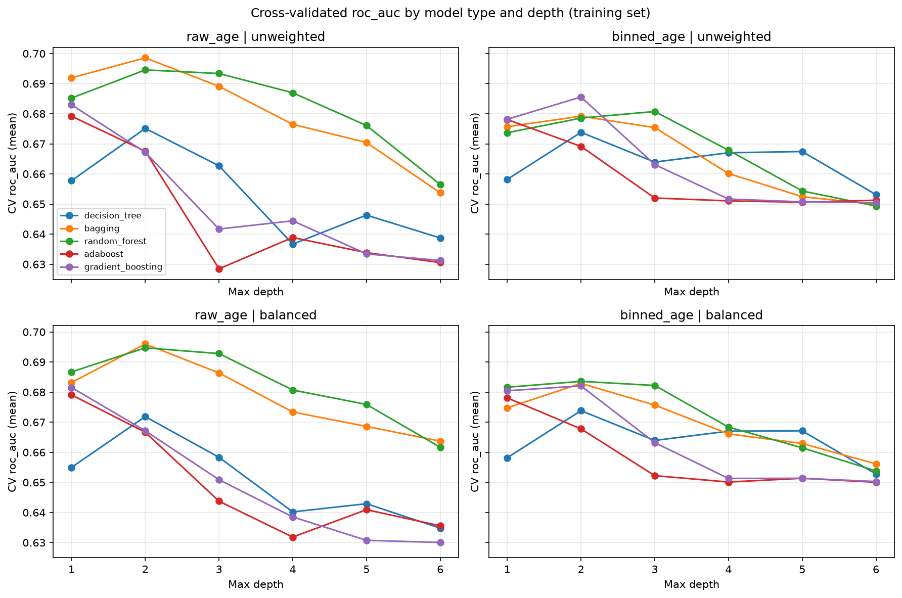
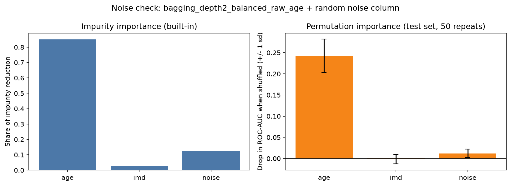
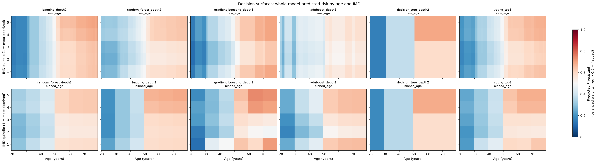
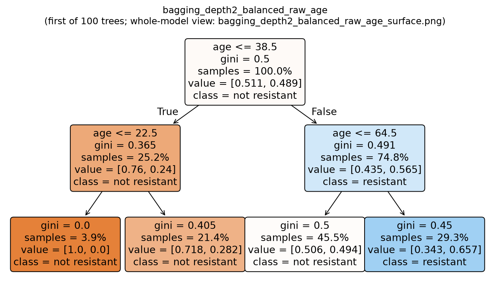

# ciuk-challenge3

Tree models for predicting E. coli resistance to co-amoxiclav (`coamox`) from patient `age` and deprivation (`imd`), built to answer:

- Which tree best identifies those at risk of antibiotic resistance?
- What are the main risk factors?

Data: a synthetic data set modelled on UKHSA surveillance data (1,000 patients, 24.1% resistant). The data and the UCL challenge brief are not in this repository.

## Summary of results

| Question | Answer |
|---|---|
| Best model | Depth-2 bagged trees with balanced class weights on raw age: test ROC-AUC **0.727**, recall 0.75, precision 0.39. Random forest, gradient boosting and soft-voting ensembles are within about 0.01 AUC, so no model is clearly better. |
| Does model complexity help? | Not really. Depth 1-2 models do as well as deeper ones, which overfit. Binning age into decades makes no meaningful difference. |
| Main risk factor | **Age.** Permutation importance is 0.24 (drop in AUC when shuffled). `imd` scores about zero, indistinguishable from a random noise column. |
| Highest-risk groups | Older patients, e.g. age > 50 (36% resistant), and age > 50 combined with less deprived IMD (42% resistant). |
| Does extra data help? | No. Adding `sex_male` and `had_surgery_past_yr` leaves test AUC unchanged (0.727 to 0.728). |

Caveats: the signal is modest (AUC about 0.73) and the test set is only 250 patients, so small differences between models are within noise. Balanced weights trade precision for recall, because resistant cases are a minority.

### Key figures

| | |
|---|---|
|  |  |
| Data overview | Test ROC curves for all models |
|  |  |
| Cross-validated AUC by depth: shallow trees are enough | Age is the only feature that beats a random noise column |

Decision surfaces: what each model predicts across every age and IMD combination.



A single tree from the best model (depth-2 bagging):



The full model comparison is in [`docs/final_model_comparison.csv`](docs/final_model_comparison.csv).

## What the script does

1. **Clean:** drop rows with missing or out-of-range `coamox`, `age` or `imd`, logging how many rows each rule removes (none were removed here).
2. **Split:** stratified 75/25 train/test split, grouped by patient `id` so one patient's tests can never appear in both sets.
3. **Compare:** 5-fold stratified, patient-grouped cross-validation on the training set only, over 120 configurations:
   - 5 model types: decision tree, bagging, random forest, AdaBoost, gradient boosting
   - depths 1-6
   - unweighted vs balanced class weights
   - raw age vs decade age bands

   Configurations are ranked by ROC-AUC.
4. **Evaluate:** the best balanced configuration of each type, for each age version (10 models), plus 2 soft-voting ensembles. Each is refitted and scored once on the test set.
5. **Risk factors:** permutation importance on the test set, checked against a random noise column.
6. **Extension:** tests whether `sex_male` and `had_surgery_past_yr` improve on `age` and `imd`.

Everything is saved to `Outputs/` (see below). The script uses a fixed random seed, so results are reproducible.

## Files

| File | Purpose |
|---|---|
| `amr_trees.py` | The analysis script |
| `dig_health_hub_amr.csv` | Data set. Not in git: download it as shown below |
| `Outputs/` | Created by the script. Not in git: run the script to regenerate it |

Built with Python 3.13, pandas, numpy, scikit-learn and matplotlib.

## Running on the UCL Condenser VM

The sections below cover setup on the UCL Condenser VM (Alma Linux). They work on any machine with Python 3.13.

## 1. Accessing the VM

Log in with the username and address from your team's Condenser access instructions:

```bash
ssh <username>@<vm-address>
```

Then clone the project and move into it:

```bash
git clone https://github.com/mmuurrrraayy/ciuk-challenge3.git
cd ciuk-challenge3
```

## 2. Creating the environment

Built for the UCL Condenser VM (Alma Linux) and tested with **Python 3.13**. No root access is needed. Graphviz, which needs root to install, is not used: tree diagrams are drawn with scikit-learn's `plot_tree` and matplotlib.

Only the packages the script imports are needed:

| Package | Used for |
|---|---|
| pandas | Loading and cleaning the data |
| numpy | Numerical work |
| scikit-learn | Models, train/test split, cross-validation, metrics, tree diagrams |
| matplotlib | Saving plots and tree diagrams |

```bash
# 1. Create the virtual environment
python3 -m venv amr_env

# 2. Activate it (your prompt should now start with "(amr_env)")
source amr_env/bin/activate

# 3. Install the pinned packages
pip install --upgrade pip
pip install pandas numpy scikit-learn matplotlib
```

If step 1 fails with an error mentioning `ensurepip`, create the environment without pip and install pip separately, then carry on from step 3:

```bash
python3 -m venv --without-pip amr_env
source amr_env/bin/activate
curl -sS https://bootstrap.pypa.io/get-pip.py | python
```

To check what is installed:

```bash
pip list
```

## 3. Accessing the environment

From the project folder, run `source amr_env/bin/activate`. Run `deactivate` to leave it.

The script prints the Python executable it is using when it starts. That path should contain `amr_env`.

## 4. Getting the data and securing it

Download the data set into the project folder:

```bash
curl -L -o dig_health_hub_amr.csv "https://drive.google.com/uc?export=download&id=1KeMv2GaR824SNW2_KDDfCrcSpIObjui0"
```

Check that it downloaded as a CSV and not as a Google Drive HTML page. You should see column headers such as `coamox`, `age` and `imd`, not `<html>`:

```bash
head -3 dig_health_hub_amr.csv
```

### File permissions

The data file was readable by every user on the VM. Even synthetic patient-level data should be treated like the real thing, so only the owner should be able to read it. Check, restrict, then check again:

```bash
ls -l dig_health_hub_amr.csv        # before: e.g. -rw-rw-rw-  (everyone can read and write)
chmod 600 dig_health_hub_amr.csv    # owner read/write only
chmod 700 .                         # project folder: owner only
ls -l dig_health_hub_amr.csv        # after:  -rw-------
```

- `chmod 600` removes all group and other access to the data.
- `chmod 700 .` stops other users listing or entering the project folder.
- The script sets `umask 077` when it starts, so everything it writes to `Outputs/` is private too: folders are `700` and files are `600`.
- The script also warns if the data file is still readable by other users.

The data file is listed in `.gitignore` so it is never committed to the repository.

## 5. Running the script

```bash
source amr_env/bin/activate
python amr_trees.py
```

It takes about 4 minutes and prints each step's progress and key tables as it goes.

Options:

```bash
python amr_trees.py --data path/to/data.csv --output path/to/folder   # defaults: dig_health_hub_amr.csv, Outputs
```

To keep it running if your SSH connection drops, run it in the background and follow the log:

```bash
nohup python amr_trees.py > run.log 2>&1 &
tail -f run.log
```

## Outputs

Everything is saved under `Outputs/`, in one folder per step. File names describe the model: `<model type>_depth<n>_<weighting>_<age version>`, e.g. `random_forest_depth2_balanced_raw_age`.

| Folder | Contents |
|---|---|
| `Outputs/01_data/` | Cleaning report and log, cleaned data, train/test split summary, data overview plot |
| `Outputs/02_trees/` | For each model: tree diagram (`.png`), text rules with a leaf table (`_rules.txt`) and decision surface (`_surface.png`). Also `decision_surfaces_all_models.png` |
| `Outputs/03_metrics/` | Cross-validation results for all 120 configurations, depth plots, test results, ROC curves, confusion matrices, `final_model_comparison.csv` |
| `Outputs/04_importance/` | Impurity vs permutation importance for the top model, and the noise check |
| `Outputs/05_extension/` | Extension: does adding `sex_male` and `had_surgery_past_yr` help? |

### Reading the tree diagrams

- **Ensembles** (bagging, random forest, AdaBoost, gradient boosting) contain 100 trees, so the diagram shows only the first one.
  - In a random forest with two features, each split may only use one randomly chosen feature, so a single tree's splits are partly chance.
  - The **decision surface** (`_surface.png`) shows what the whole model predicts for every age and IMD combination, so use it to interpret ensembles and voting models.
- For gradient boosting, node values are log-odds corrections, not probabilities.
- Models are trained with balanced weights, so node `value`s are weighted. The leaf table in each `_rules.txt` gives the real % resistant in each leaf.

## Optional: installing the micro text editor

The VM only has vim. To install micro into the current folder without root:

```bash
curl https://getmic.ro | bash
./micro README.md
```
